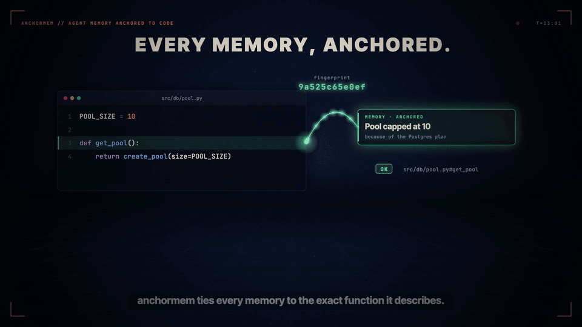
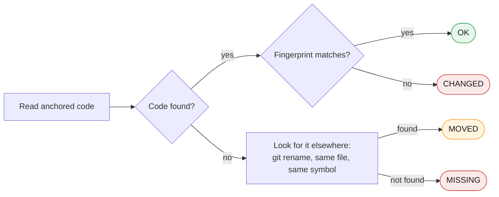
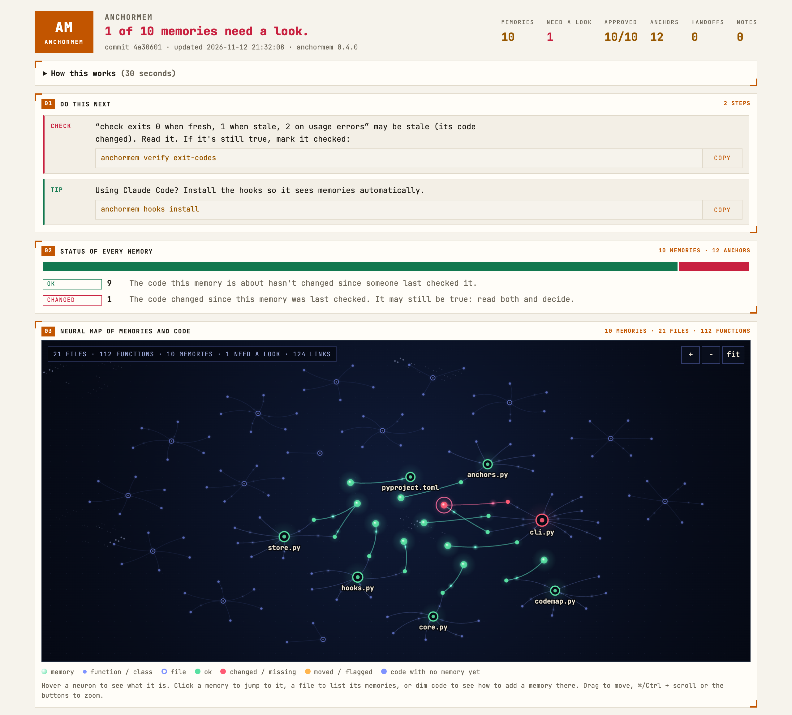

<p align="center">
  
</p>

<p align="center">
  <a href="https://github.com/ChiragPatankar/anchormem/actions/workflows/ci.yml"></a>
  
  
  
  <a href="LICENSE"></a>
</p>

<p align="center">
  <a href="#try-it-in-one-command"><b>Try it</b></a> ·
  <a href="#how-it-works"><b>How it works</b></a> ·
  <a href="#use-it-with-claude-code"><b>Claude Code</b></a> ·
  <a href="#the-dashboard"><b>Dashboard</b></a> ·
  <a href="#reference"><b>Reference</b></a>
</p>

Coding agents (Claude Code, Codex, Cursor and the rest) forget everything between sessions, so people give them memory files: notes like *"the pool is capped at 10 because of our Postgres plan"*. Then the code changes. The note stays, and the agent keeps trusting it.

**anchormem ties every memory to the exact code it describes.** When that code changes, moves or disappears, the memory is flagged before the agent relies on it. No LLM does the checking, so it takes milliseconds and costs no tokens.

<p align="center">
  
</p>

```console
$ anchormem check
✗ pool-capped-10-postgres-plan  CHANGED     src/db/pool.py#POOL_SIZE  since 8f5a37e

1 of 1 memories need checking (1 anchors)
```

> [!TIP]
> Reformatting code never flags anything: fingerprints ignore whitespace. Renaming a file is followed, not lost.

## Try it in one command

```bash
pip install git+https://github.com/ChiragPatankar/anchormem
anchormem try https://github.com/psf/requests
```

`try` clones the latest commit of any repo into a temporary folder, turns the comments that explain its code into memories, and opens the live dashboard. On psf/requests that gives 41 memories, each anchored to the function it describes. Edit a function in the copy and watch its memories turn red. Nothing touches your own files, and the copy is deleted when you press Ctrl+C.

No network? `bash examples/demo.sh` builds a throwaway repo, changes and renames code, and shows every command's output.

## Use it in your repo

```bash
cd your-repo
anchormem init --hooks          # --hooks only if you use Claude Code
anchormem seed --apply          # start from the comments you already have
anchormem add "Pool capped at 10 because of the Postgres plan" \
  --anchor src/db/pool.py#POOL_SIZE \
  --body "Hosted plan allows 25 connections across 2 workers. Raise it only after upgrading."
```

Then two commands cover a normal day:

```bash
anchormem              # where things stand, and exactly what to run next
anchormem dashboard    # everything, in your browser
```

Memories are plain Markdown in `.anchormem/memories/`, committed with your code. No database, no server, no API key.

## How it works

Every memory has an **anchor**: a file, a function or constant (`#get_pool`), a method (`#App.build`) or a line range (`:10-24`). When a memory is saved, the anchored code is fingerprinted with all whitespace removed. Every check reads the code again and compares:



Python symbols are found with Python's own parser. JavaScript, TypeScript, Go, Rust, Java, C# and similar languages use a text-based finder that matches braces. A memory can have several anchors; it's stale if any of them is.

<details>
<summary><b>All six statuses, and what to do about each</b></summary>

| Status | Meaning | What to do |
|---|---|---|
| `OK` | The anchored code is unchanged since the memory was last verified. | Nothing. |
| `CHANGED` | The code is different. | Read the memory and the code. If it's still true, `anchormem verify <id>`. If not, edit it or retire it. |
| `MOVED` | The file was renamed, or the symbol now lives in another file. | `anchormem verify <id> --follow` updates the anchor. |
| `MISSING` | The file or symbol is gone. | Edit the anchor, or `anchormem retire <id> --reason "..."`. |
| `UNVERIFIED` | The anchor was written by hand and has no fingerprint yet. | `anchormem verify <id>`. |
| `FLAGGED` | An agent reported the memory outdated, even though its code didn't change. | Check it. `anchormem verify <id>` clears the flag. |

</details>

<details>
<summary><b>What a memory file looks like</b></summary>

```markdown
---
id: pool-capped-10-postgres-plan
title: Pool capped at 10 because of the Postgres plan
origin: user
created: 2026-11-12
verified: 2026-11-12
commit: 8f5a37e
anchors:
  - src/db/pool.py#POOL_SIZE  # fp:9a525c65e0ef
---
Hosted plan allows 25 connections across 2 workers. Raise it only after upgrading.
```

The frontmatter is valid YAML, and each fingerprint is a YAML comment, so you can edit these files by hand. An anchor you add without a fingerprint shows as `UNVERIFIED` until you run `verify`.

```
.anchormem/
  memories/        active memories (commit these)
  retired/         retired memories, with reasons
  handoffs/        handoffs between sessions
  inbox.jsonl      notes waiting to be promoted
  log.md           append-only change log
  .state/          per-machine hook state (gitignored)
```

</details>

## Use it with Claude Code

```bash
anchormem hooks install        # .claude/settings.json; --local writes settings.local.json and gitignores it
```

Restart Claude Code, and two hooks deliver memories at the moment they matter:

- **SessionStart** gives the agent a short briefing before your first prompt: how many memories exist, which are stale and why, any handoff left for it, and how to fix things.
- **PostToolUse**, after `Read`, `Edit`, `Write`, `MultiEdit` or `NotebookEdit`, shows the memories anchored to that file. Edit a function and the agent sees its memory flip from `[OK]` to `[STALE: CHANGED]` in the same turn. Each file is shown once per session, and again only when a status changes, capped at about 3,000 characters.

> [!NOTE]
> The hooks never fail a session: any error makes them exit quietly. `anchormem hooks remove` takes them out and leaves the rest of your settings alone. Codex, Cursor and other agents follow the rules `init` writes into `AGENTS.md` and run `anchormem context <file>` themselves.

## The dashboard

<picture>
  <source media="(prefers-color-scheme: dark)" srcset="docs/media/dashboard-dark.png">
  
</picture>

```bash
anchormem dashboard            # one HTML file, opened in your browser
anchormem dashboard --serve    # live on 127.0.0.1: updates by itself as code changes
```

- **Do this next:** every stale memory, waiting handoff and unapproved memory, with its exact command and a copy button.
- **Neural map:** the repo's files and functions as neurons, with memories lit up on top. Stale memories pulse red, and in `--serve` mode turn green the moment you verify them. Hover a neuron, click a memory to jump to it, or click bare code to get the command for adding a memory there.
- **Every memory** in a searchable, filterable table, plus activity, handoffs, notes, lint findings and the log.

It follows your light or dark setting and works on a phone.

## More features

<details>
<summary><b>Seed memories from the comments you already have</b></summary>

```bash
anchormem seed            # lists what it found, writes nothing
anchormem seed --apply    # saves them
```

`seed` picks up tagged comments in any case (`NOTE:`, `Note that …`, `WHY:`, `HACK:`, `IMPORTANT:`, `WARNING:`, `SAFETY:`, `INVARIANT:`, `CAUTION:`, `NB:`) and untagged comments that give a reason (*because*, *must go after*, *never*, *to avoid*, *otherwise*, *workaround*), when they sit inside or right above a function. `--tagged-only` turns the second kind off. It skips to-dos, license headers, commented-out code, linter directives, and untagged comments in docs and tests. Everything it writes is marked agent-written and unapproved. Running it again doesn't add duplicates.

</details>

<details>
<summary><b>Who wrote it: agent memories wait for a person's OK</b></summary>

Every memory records its `origin` (`user` or `agent`). Inside Claude Code, `add` defaults to `agent`; `--by` overrides it. An agent-written memory is labelled "written by an agent and not yet confirmed by a person" wherever an agent sees it, until you approve it:

```bash
anchormem confirm         # goes through every waiting memory: y = right, n = skip, q = stop
anchormem confirm <id>    # or just one
```

`confirm` refuses when nobody is at a terminal, so an agent can't approve its own notes (`--yes` skips the question, for scripts you trust).

</details>

<details>
<summary><b>Confidence: did the memory hold up?</b></summary>

```bash
anchormem feedback pool-size-why applied      # it held
anchormem feedback pool-size-why violated     # the code or the user contradicted it
anchormem feedback pool-size-why outdated --note "plan upgraded to 100 connections"
```

The score is the Wilson 95% lower bound on applied / (applied + violated), faded to zero over 180 days without new reports or a `verify`. One good report gives *low*; it takes several to reach *high*. Better-supported memories are listed first, and `lint` warns when a memory is violated at least as often as it holds. `outdated` flags the memory so `check` fails until someone verifies it.

</details>

<details>
<summary><b>Handoffs between sessions and agents</b></summary>

```bash
anchormem handoff new "Switched lineTotal to banker's rounding; totals tests still fail" \
  -n "update the totals fixture in tests/billing" -q "half-even for refunds too?" --to codex
```

A handoff records the summary, next steps, open questions and the files in play (by default, whatever has uncommitted changes), each fingerprinted. The next session runs `anchormem handoff take` and sees which of those files changed since. A handoff can be taken once and expires after 7 days. With the Claude Code hooks, a new session takes the newest pending handoff automatically, and shows it again after a resume or compaction.

</details>

<details>
<summary><b>Notes that become memories</b></summary>

```bash
anchormem note src/db/pool.py#POOL_SIZE "pool size seems tied to the postgres plan"
anchormem promote --apply
```

Notes go to `.anchormem/inbox.jsonl`. Three similar notes on one anchor within 30 days make a candidate, and `promote --apply` turns it into one agent-written memory.

</details>

<details>
<summary><b>Keeping memory clean: retire, lint, log</b></summary>

- **Retire instead of delete.** `anchormem retire <id> --reason "plan upgraded" [--superseded-by <id>]` moves a memory to `.anchormem/retired/` with the reason and date; `restore` brings it back.
- **Lint.** `anchormem lint` finds duplicates, possible contradictions, empty explanations, file paths that don't exist, fragile line-range anchors, and agent-written memories containing risky instructions such as `curl … | sh`. No LLM, no network. `--strict` makes warnings fail the run.
- **Log.** Every add, verify, confirm, retire and restore is one line in `.anchormem/log.md`, marked `merge=union` so branches merge without conflicts.

</details>

## In CI

`anchormem check` exits 0 when everything is fresh, 1 when anything is stale and 2 on usage errors. Copy [examples/github-action.yml](examples/github-action.yml) to `.github/workflows/`, and a pull request that changes code without re-checking its memories fails. This repo checks [its own memories](.anchormem/memories) the same way.

<details>
<summary><b>Or check before every commit</b></summary>

Add this as `.git/hooks/pre-commit`:

```bash
#!/bin/sh
exec anchormem check -q
```

</details>

## Reference

<details>
<summary><b>All commands</b></summary>

| Command | What it does |
|---|---|
| `anchormem` / `anchormem status` | Where things stand and what to run next. |
| `anchormem init [--claude] [--hooks] [--dry-run] [--remove]` | Creates `.anchormem/` and writes the agent rules between marked lines in `AGENTS.md` (and `CLAUDE.md`). |
| `anchormem add "<title>" -a <anchor> [-a …] [--body …] [--id …] [--by user\|agent]` | Saves a memory. Fails if an anchor doesn't point at real code. The body can be piped in (`--body -` forces reading stdin). |
| `anchormem check [ids…] [--json] [-q] [-v]` | Checks every memory against the code. Exits with 1 if anything is stale. |
| `anchormem context <paths…> [--all] [--budget N] [--json]` | Prints the memories relevant to those files for an agent to read, stale ones first. |
| `anchormem verify <id…> [--follow]` | Marks memories as still true and records new fingerprints. |
| `anchormem confirm [ids…]` | Lets a person approve memories an agent wrote. |
| `anchormem retire <id…> -r <reason> [--superseded-by <id>]` / `restore <id…>` | Retires memories with a reason, or brings them back. |
| `anchormem feedback <id> applied\|violated\|outdated [--note …]` | Reports whether a memory held up. |
| `anchormem handoff new\|list\|take …` | Leaves or picks up unfinished work between sessions. |
| `anchormem note <anchor> "<text>"` / `promote [--apply]` | Jots an observation, and turns repeated ones into memories. |
| `anchormem seed [--apply] [--limit N] [--tagged-only]` | Turns comments that explain the code into memories. |
| `anchormem try <git-url-or-folder> [--keep]` | Clones a repo to a temp folder, seeds it and opens the live dashboard. |
| `anchormem dashboard [--serve] [-o FILE] [--open\|--no-open]` | Opens the dashboard. `--serve` keeps it live. |
| `anchormem lint [--strict] [--json]` | Checks the memories themselves for problems. |
| `anchormem doctor` | Checks the setup: memory files, agent rules, hooks, PATH, gitignore, git. |
| `anchormem hooks install\|remove [--local] [--dry-run]` | Installs or removes the Claude Code hooks. |
| `anchormem list [--retired] [--json]` / `rm <id…>` | Lists or deletes memories. |

</details>

<details>
<summary><b>Anchor forms</b></summary>

| Anchor | Points at |
|---|---|
| `src/db/pool.py` | the whole file |
| `src/db/pool.py#get_pool` | a function, class or constant |
| `src/api/app.py#App.build` | a method inside a class |
| `src/config.py:10-24` | a line range (fragile, so prefer symbols) |

Paths are relative to the repo root, or to your current folder when you type them.

</details>

<details>
<summary><b>Where the ideas came from</b></summary>

- **Hook delivery with a size limit:** open-second-brain and ai-memory.
- **Instruction block between marked lines, `--remove`, `doctor`, and trust labels:** gbrain.
- **Retiring with a reason instead of deleting:** open-second-brain and ai-memory.
- **Rule-based lint and an append-only log:** Karpathy's LLM wiki, ai-memory and COG.
- **Evidence-based confidence and a notes inbox that promotes after repeats:** open-second-brain.
- **One-time handoffs between agents:** ai-memory.

What anchormem adds is the anchor: memory tied to specific code, so it can tell when it's out of date.

</details>

## Development

```bash
python3 -m unittest discover -s tests
```

Python 3.9+, standard library only. CI runs the tests on Linux, macOS and Windows with Python 3.9 and 3.13.

## License

MIT
